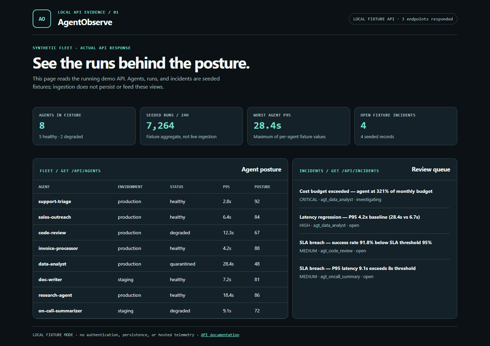

# AgentObserve

Fixture-backed reference API for agent fleet observability: cost, regression, SLA, and posture calculations over seeded runs.

The project demonstrates how cost, regression, and SLA signals could be combined into an operator review. It is a reference implementation, not an on-call service.

## Project Overview

| Attribute | Detail |
| --- | --- |
| Runtime | Node.js + TypeScript |
| Framework | Express 5 |
| Domain | AI agent fleet observability and runtime governance |
| Detectors | Cost anomaly · Cost-budget verdict · Latency regression · Output drift · Tool-loop detection · Retry excess · SLA evaluation |
| Operational Outputs | Run audits · Posture scoring · Incident records · Cost-budget verdicts · SLA reports |
| Data Model | Agent fleet · Runs · Spans · Sessions · Baselines · Incidents |
| Docs | Swagger UI at `/docs` |

## Executive Summary

AgentObserve demonstrates calculations a platform operator could use to review agent runs: cost against a budget, latency against a baseline, and incidents against SLA targets. The inputs in this repository are seeded fixtures. No runtime agent instrumentation or on-call integration is connected.

The API validates a submitted run and returns a summary, but does not store or evaluate that submission. Evaluation routes operate on seeded agent, run, baseline, and incident fixtures. The local `/demo/runtime.html` page reads the running API, so its screenshot can be reproduced without implying hosted telemetry.

**Release boundary:** this is a local demo. It binds to `127.0.0.1`; `NODE_ENV=production` rejects startup and imports of the app or route modules because authentication, tenant isolation, retention, and persistence are absent. Do not send real run contents or personal data to it.

## Architecture

    POST /api/ingest/run -> validate and summarize; no storage or detector update
    Seeded runs + baselines -> evaluation routes -> calculated demo verdicts
    Seeded agents + incidents -> read-only local evidence page at /demo/runtime.html

## Governance Workflow

1. Submit a synthetic run to `/api/ingest/run` to check shape and a calculated span summary; the response says `persisted: false` and `evaluated: false`.
2. Call evaluation routes with IDs from the seeded fixtures to inspect detector calculations and posture verdicts.
3. Open `/demo/runtime.html` to inspect the fixture API responses in a local browser.

## Validation Model

### Cost Anomaly Detection

Cost evaluation per run covers:

- run cost compared to agent baseline P95 (multiplier flag at 1.5x, block at 2.5x)
- projected monthly spend vs declared monthly budget (warn at 80%, block at 100%)
- seeded budget-breach incident examples
- projected spend compared with the seeded monthly budget

### Regression Detection

Each finished run is evaluated against:

- latency multiplier vs baseline P95 (regression threshold 1.5x)
- output length z-score drift vs baseline mean and standard deviation
- tool-call loop detection (configurable max repeats per tool, default 4)
- retry excess (3+ retries on a single span family)
- terminal status check (anything other than `ok` deducts posture points)

### SLA Evaluation

Per-agent SLA scoring includes:

- P95 latency vs SLA threshold
- success rate vs SLA threshold
- error budget remaining (computed against allowed error rate)
- calculated SLA score over seeded fixture windows

### Run Audit Decision

The combined run-audit endpoint produces a single operational verdict per run:

- no-findings
- needs-review
- blocked

## API Endpoints

| Method | Endpoint | Purpose |
| --- | --- | --- |
| GET | `/health` | Service status and uptime |
| GET | `/api/agents` | List registered agents in the fleet |
| GET | `/api/agents/:id` | Fetch one agent record |
| GET | `/api/agents/:id/baseline` | Fetch the rolling baseline metrics for one agent |
| GET | `/api/runs` | List recent agent runs |
| GET | `/api/runs/:id` | Fetch a single run with its full span trace |
| GET | `/api/incidents` | List open and recent incidents |
| GET | `/api/dashboard/summary` | Operations summary view |
| POST | `/api/ingest/run` | Validate and summarize a run; does not persist or evaluate it |
| POST | `/api/evaluate/regression` | Evaluate a run for latency regression, output drift, and tool loops |
| POST | `/api/evaluate/cost-anomaly` | Evaluate a run cost vs agent baseline P95 and monthly budget |
| POST | `/api/evaluate/sla` | Evaluate agent SLA compliance over a time window |
| POST | `/api/evaluate/run-audit` | Combined posture audit on one run (regression + cost) |

## Sample Validation Request

    POST /api/evaluate/run-audit
    Content-Type: application/json

    {
      "runId": "run_8a91fe"
    }

The endpoint returns a calculated verdict over a seeded run. It does not block agent traffic or create an incident in another system.

## Local API Screenshot

Captured from `http://127.0.0.1:3001/demo/runtime.html` against this repository's local server. Values are synthetic fixtures, and the page fetches `/api/dashboard/summary`, `/api/agents`, and `/api/incidents`. See `dashboard-preview/runtime.html` and `dashboard-preview/runtime.js` for the source.

## Getting Started

### Prerequisites

- Node.js 20+
- npm

### Setup

    git clone https://github.com/mizcausevic-dev/agentobserve.git
    cd agentobserve
    npm ci
    npm run dev

Visit:

- `http://127.0.0.1:3001/demo/runtime.html`
- `http://127.0.0.1:3001/docs`
- `http://127.0.0.1:3001/api/runs/run_8a91fe`

### Run Tests

    npm test

## What This Demonstrates

- Agent observability framed as a fleet-operator problem rather than a prompt-debugging problem
- cost calculations against seeded per-agent budgets and baselines
- latency-regression and output-drift detection against seeded baselines
- explicit SLA model with error-budget accounting, not just a percent-up display
- combined posture verdict per run with a recommended next action — designed to back an on-call console
- TypeScript API structure with Swagger, unit tests, and explicit demo boundaries

## Future Enhancements

- persist runs, spans, baselines, and incidents in PostgreSQL with rolling-window materialized views
- ship a Node and Python SDK so agent runtimes can emit runs in one line
- streamable ingestion endpoint over SSE for live trace viewers
- pluggable detector framework so teams can author custom regression rules
- export incidents to PagerDuty, Slack, and SIEMs through a unified webhook adapter
- bidirectional integration with mcp-sentinel for tool-surface posture context on each run
- multi-tenant control plane with per-team fleet isolation

## Tech Stack

- Node.js
- TypeScript
- Express 5
- Zod
- Swagger / OpenAPI
- Helmet
- Morgan
- Node test runner + Supertest

## Portfolio Links

- [LinkedIn](https://www.linkedin.com/in/mizcausevic/)
- [Skills Page](https://mizcausevic.com/skills)
- [Medium](https://medium.com/@mizcausevic)
- [GitHub](https://github.com/mizcausevic-dev)

Part of [mizcausevic-dev's GitHub portfolio](https://github.com/mizcausevic-dev) as a fixture-backed platform observability reference.

---

**Connect:** [LinkedIn](https://www.linkedin.com/in/mirzacausevic/) · [Kinetic Gain](https://kineticgain.com) · [Medium](https://medium.com/@mizcausevic/) · [Skills](https://mizcausevic.com/skills/)
